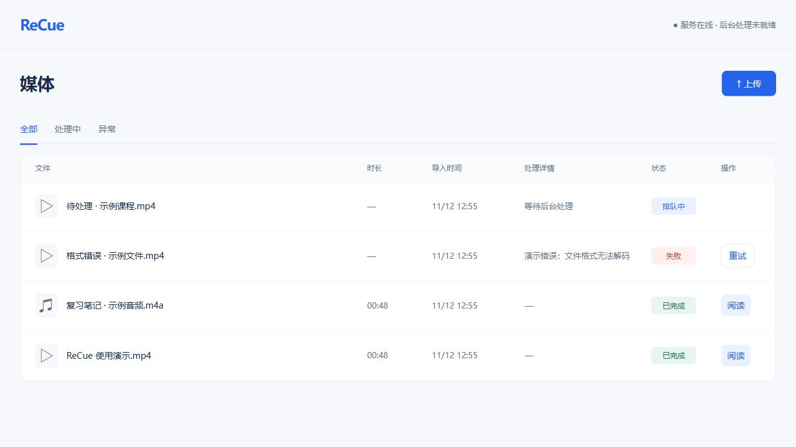

# ReCue

把本地音视频变成可点击定位的讲稿，方便回看课程、核对原话和复习。

ReCue 是面向个人及可信局域网的自托管工具。媒体、讲稿和识别计算保留在处理电脑，浏览器负责上传、播放和阅读。采用 React + TypeScript、FastAPI、SQLite 与 whisper.cpp CPU 转写。

> **开发中（0.1）**：上传 → 转写 → 播放阅读的核心流程已接通；搜索、播放高亮、进度恢复和删除尚未实现。当前完整转写服务需要 Windows 10+。

## 界面预览

以下为当前版本的真实界面，使用自制演示媒体和预置示例讲稿，不包含私人课程；示例任务状态与讲稿仅用于界面展示，不作为转写质量或处理能力的验收证据。

**媒体列表**：查看排队、完成和失败状态，打开讲稿或重试失败任务。



**桌面阅读**：播放器与讲稿并排，支持倍速与点击句子定位。


<details>
<summary>窄屏阅读预览</summary>

播放器与讲稿在窄屏上下排列。


</details>

## 功能与路线图

| 状态 | 功能 |
| --- | --- |
| 已实现 | 每批选择 1–5 个文件，串行流式上传、逐文件进度和接收结果查询 |
| 已实现 | 媒体列表、分页、状态筛选、后台单任务队列、失败/中断重试 |
| 已实现 | FFmpeg 校验和预处理、本地 Whisper CPU 转写、讲稿完整发布 |
| 已实现 | 同屏音视频与讲稿、原生播放控制和倍速、点击句首提前 0.3 秒播放 |
| 已实现 | 已发布播放副本的 HTTP Range 读取、进程树保护与中断恢复基础 |
| 待实现 | 讲稿关键词搜索、命中导航、当前播放句高亮与自动跟随 |
| 待实现 | 播放进度保存/恢复、完成标记、从头播放 |
| 待实现 | 删除确认、运行任务取消与异步文件清理体验 |
| 待验收 | 识别质量和句首精度、60 分钟稳定性、5 文件完整批量、断线边界、第二台电脑与完整离线流程 |

当前转写固定中文、CPU、8 线程，不启用 VAD 或分块；模型仍是实验基线，尚未完成最终选型。工程上限为单文件 4 GiB、120 分钟，这些上限不代表已通过同规模实测。MKV、MP4、MP3、WAV 等本地文件是否可处理取决于实际编码、音轨及完整解码结果，不保证所有格式组合。

## 环境要求

- [Node.js](https://nodejs.org/) 与 npm：20.19+ 或 22.12+（建议使用受支持的 LTS）。
- [uv](https://docs.astral.sh/uv/getting-started/installation/)：统一管理 Python 和后端依赖，无需自行激活虚拟环境。Python 版本见 `.python-version`。
- [FFmpeg 与 FFprobe](https://ffmpeg.org/download.html)：加入 PATH，FFmpeg 构建需包含 `libx264` 与 AAC 编码器。
- 转写另需自行准备 [whisper.cpp](https://github.com/ggml-org/whisper.cpp) 的 `whisper-cli` 和兼容的多语言 GGML 模型；仓库不附带可执行工具或权重。

| 平台 | 安装/启动脚本 | API 与界面 | 自动转写 |
| --- | --- | --- | --- |
| Windows 10+ | 统一 Node.js 入口；保留 PowerShell 兼容入口 | 已验证 | 已验证核心流程 |
| macOS / Linux | 使用相同 Node.js 命令；尚未实机验证 | 可用于开发，尚未实机验收 | 暂不支持；依赖 Windows Job Object，入口会明确拒绝启动 worker |

## 快速开始

下载或克隆本仓库，在项目根目录打开终端。首次安装需要网络：

```sh
node scripts/recue.mjs setup
```

该命令按锁文件安装 Python/npm 依赖并构建前端，不自动下载 FFmpeg、Whisper 或模型。

### 1. 配置本地转写（Windows）

1. 准备 `whisper-cli.exe` 和多语言 GGML 模型。开发中使用过 whisper.cpp `b5454` 与 `medium-q5_0`，仅作为可运行基线，并非质量推荐。
2. 复制 [处理配置示例](examples/processing.example.json) 为 `processing.local.json`，填写真实绝对路径、引擎版本/commit、模型 revision 和 SHA-256。
3. 设置配置路径后启动（PowerShell）：

```powershell
Get-FileHash 'C:/ReCue/tools/whisper-cli.exe' -Algorithm SHA256
Get-FileHash 'C:/ReCue/models/ggml-medium-q5_0.bin' -Algorithm SHA256
# 将哈希以小写写入 JSON 对应字段，并填写其他部署信息
$env:RECUE_PROCESSING_CONFIG = (Resolve-Path ./processing.local.json).Path
node scripts/recue.mjs start
```

工具和模型获取方式见 whisper.cpp 官方说明；记录所下载/构建的实际固定版本和来源，不要把示例占位符当作可用配置。修改配置后须重启 worker。配置缺失或无效时，worker 显示 `blocked_config`，上传仍可接收，任务保持排队；不会自动选择或降级模型。

### 2. 打开与使用

访问 [本机首页](http://127.0.0.1:4318/)，上传文件并等待处理完成。点击「阅读」查看播放器与完整讲稿，点击讲稿定位播放。打开阅读页时暂停，当前不会保存播放位置。

上传后可关闭浏览器，后台继续处理。上传过程中请保持页面打开；响应不明时先「查询结果」。不支持断点续传，刷新页面会丢失当前页面的上传查询入口，请先检查媒体列表。

macOS/Linux 仅启动 API 与界面用于开发：

```sh
node scripts/recue.mjs start --service api
```

### 3. 停止服务

在启动终端按 `Ctrl+C`，或在另一终端运行：

```sh
node scripts/recue.mjs stop
```

可使用 `--service api` 或 `--service worker` 分开启停；停止时必须使用与启动相同的 `--service` 和 `RECUE_DATA_DIR`，并等待启动终端退出。Windows 旧入口 `scripts/setup.ps1`、`start.ps1`、`stop.ps1` 仍可使用，服务参数仍为 `-Service`。

## 配置与数据

配置通过启动终端的环境变量传入；当前不自动读取 `.env` 文件。

| 环境变量 | 默认值 | 用途 |
| --- | --- | --- |
| `RECUE_HOST` | `127.0.0.1` | API 监听地址 |
| `RECUE_PORT` | `4318` | API 端口 |
| `RECUE_DATA_DIR` | 项目下 `data/` | 数据库、原文件、播放副本与运行记录；自定义时须用绝对路径 |
| `RECUE_FFMPEG` | `ffmpeg` | FFmpeg 命令或绝对路径；FFprobe 在处理 JSON 中设置 |
| `RECUE_PROCESSING_CONFIG` | 未设置 | 处理 JSON 的绝对路径 |
| `RECUE_MODEL_PATH` | 未设置 | 旧预检兼容项，仅检查文件存在，不能替代处理 JSON |

默认仅本机访问。可信局域网使用时设置 `RECUE_HOST=0.0.0.0`，按需放行防火墙，再通过处理电脑的局域网 IP 和端口访问。**当前没有登录或访问控制，请仅用于个人可信网络，不开放公网。** 第二台电脑访问尚未完成实机验收。

数据保存在 `data/`，依赖、模型及本地配置不进入 Git。备份应在停止 API/worker 并确认工具清理完成后复制整个数据目录，配置和模型另行保管。若出现 `runtime/processing.guard` 清理阻塞，先检查 `runtime/guardian.log`；未确认整棵工具进程树退出时不要手动删除标记。

依赖和模型就绪后，启动使用 `uv --offline --locked`，前端不使用 CDN；整机断网后的完整产品流程尚待验收。

## 开发与验证

```sh
uv lock --check --offline
uv pip check
uv run --offline --locked python -m unittest discover -s tests -v
npm --prefix frontend run api:check
npm --prefix frontend run build
```

修改 API Schema 后运行 `npm --prefix frontend run api:generate` 更新前端类型。应用与类型生成工具使用独立 TypeScript 工作区，依赖版本由锁文件管理。

```text
backend/app/      API、存储、队列、预处理与转写
frontend/src/     媒体列表、阅读播放器与生成的 API 类型
scripts/          通用安装/启动/停止入口与 PowerShell 兼容入口
examples/         可公开的部署配置示例
tests/           后端与启动流程测试
```

详细接口、错误和恢复规则见 [使用与 API 参考](USAGE.md)。

## 帮助与贡献

由 ReCue 维护者与贡献者维护。欢迎通过本仓库 Issues 报告问题、提出建议，通过 Pull Request 贡献改进。报告时请附系统、依赖版本、复现步骤和脱敏错误；不要上传课程原文、讲稿、模型或包含个人路径的日志。提交代码前运行相关验证，API 变更需同步生成类型。

## 许可证

本项目源码采用 [MIT License](LICENSE)。允许个人使用、修改、商用与再分发；在软件副本或实质性部分中须保留版权声明和许可声明，无需强制公开修改后的源码。

此许可不要求在每个界面或广告中展示项目名称。模型权重、FFmpeg、whisper.cpp 和其他第三方依赖各自遵循原许可，不因被本项目调用而改用 MIT。
