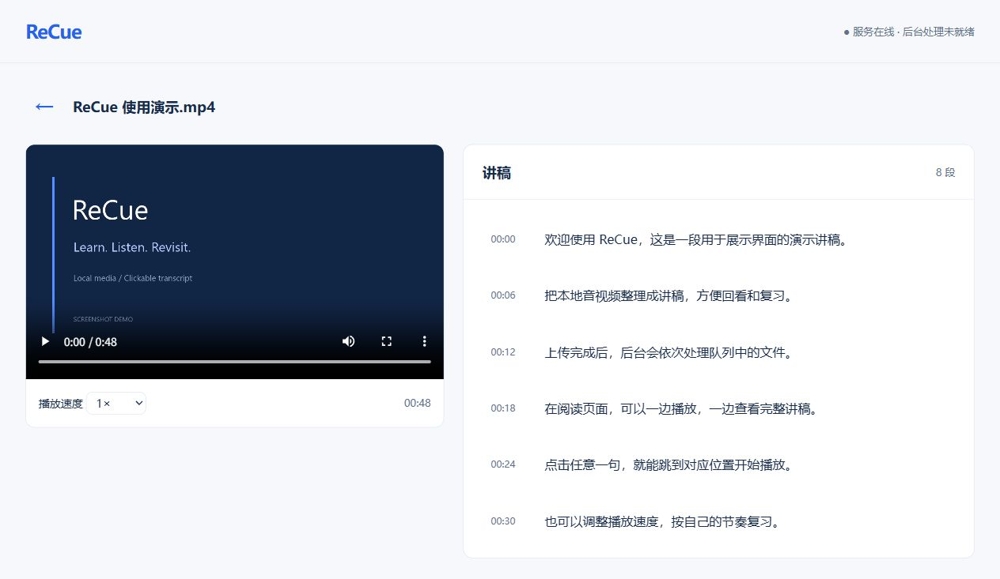

# ReCue

**上传本地音视频，生成可点击定位的讲稿。** 用来回看课程、搜索原话、边听边复习。

媒体、讲稿和识别计算都留在你的电脑上，浏览器负责操作。当前为 **0.1 开发版，支持 Windows 10+ 和 macOS 本地转写**。

## 首次启动

1. 在处理电脑上按[安装与模型下载](USAGE.md#安装与模型下载)准备工具和一个转写模型。
2. 在项目根目录运行 `node recue.mjs`，按提示选择模型，以及仅本机使用还是允许局域网访问。
3. 看到「ReCue 网页已就绪」后，打开终端显示的地址。在「转写任务」页选择音视频，点击「提交转写」。完成后点击「阅读」。

在同一个可信局域网里，可用终端显示的「局域网打开」地址从另一台设备访问。启动时会自动查找地址。需要更改访问方式时，运行 `node recue.mjs configure` 后重启。ReCue 无需登录，请仅在可信网络开放访问。[局域网访问与排查](USAGE.md#局域网访问)

## 从上传到阅读



每批最多上传 5 个文件。处理完成后，点击「阅读」即可搜索原话、点击句子播放。下次打开时会恢复播放位置。截图使用演示媒体和预置讲稿。

阅读页可拖动分隔条调节视频与讲稿比例，切换时间轴或文章视图。文章通过本地标点模型补标点并分段，已有媒体也可使用；首次需按[文字稿准备说明](USAGE.md#文章式文字稿)下载一次模型。

在时间轴上点击片段旁的「编辑」可以修正转写文字。保存后，搜索和文章视图会使用修订后的文字，点击片段仍会跳到原来的时间。

## 停止与数据

在启动终端按 `Ctrl+C`，或运行 `node stop.mjs` 后等待启动终端退出。数据默认保存在项目的 `data/` 文件夹中。[使用手册](USAGE.md)提供模型设置、日常操作、排障和备份恢复步骤。

## 开发

Linux 可用 `node recue.mjs --service api` 开发 API 与界面。

`frontend/src/` 是网页源码，`backend/app/` 是 API 和转写逻辑，`recue.mjs` 是启动入口，`tests/` 是后端测试。运行中的服务通过 `/openapi.json` 提供接口定义。

```bash
uv run --offline --locked python -m unittest discover -s tests -v
node --test frontend/tests/library.test.mjs
npm --prefix frontend run api:check
npm --prefix frontend run build
```

API Schema 有改动时运行 `npm --prefix frontend run api:generate`。欢迎通过 Issues 或 Pull Request 反馈与贡献；请附系统、版本、复现步骤和脱敏错误，不要上传私人媒体、讲稿或模型。

## 许可证

源码采用 [MIT License](LICENSE)，允许个人使用、修改、商用与再分发，须保留版权及许可声明。模型权重、FFmpeg、whisper.cpp 等第三方依赖遵循各自许可。
