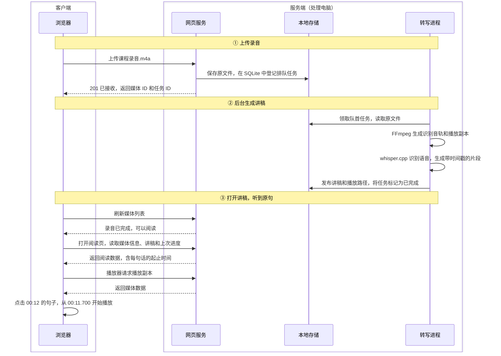

# ReCue

**上传本地音视频，生成可点击定位的讲稿。** 用来回看课程、搜索原话、边听边复习。

媒体、讲稿和识别计算都留在你的电脑上，浏览器负责操作。当前为 **0.1 开发版，支持 Windows 10+ 和 macOS 本地转写**。

## 从上传到阅读


每批最多上传 5 个文件。处理完成后，点击「阅读」即可搜索原话、点击句子播放。下次打开时会恢复播放位置。截图使用演示媒体和预置讲稿。

阅读页可拖动分隔条调节视频与讲稿比例，切换时间轴或文章视图。文章通过本地标点模型补标点并分段，已有媒体也可使用；首次需按[文字稿准备说明](USAGE.md#文章式文字稿)下载一次模型。

## 一段录音如何变成可点击的讲稿

假设你上传了 `课程录音.m4a`，想重听老师在第 12 秒讲的那句话。从上往下看，每一步都发生在对应的一列里。



上传请求在「已接收」时结束。此后转写进程独立工作，媒体列表会定时查询进度。点击句子时，浏览器用讲稿时间戳定位，提前 0.3 秒起播，方便听清句首。

## 首次启动

在处理电脑上准备以下工具。

| 准备什么 | 要求 |
| --- | --- |
| [Node.js 与 npm](https://nodejs.org/)、[uv](https://docs.astral.sh/uv/getting-started/installation/) | Node 20.19+ 或 22.12+，uv 管理 Python |
| [FFmpeg 与 FFprobe](https://ffmpeg.org/download.html) | 两者都加入 PATH，FFmpeg 支持 libx264 和 AAC |
| [whisper.cpp](https://github.com/ggml-org/whisper.cpp) | 适用于当前系统的 `whisper-cli` 和配套运行库，以及一个支持中文的多语言 GGML 模型 |

1. Windows 可双击项目根目录的 `Start.cmd`。macOS 在项目根目录运行 `bash scripts/start.sh`。首次启动会联网安装项目依赖并构建网页。
2. 按提示输入 **whisper-cli 路径**（Windows 为 `whisper-cli.exe`）和**模型文件路径**。脚本计算哈希、保存配置，然后启动服务。
3. 打开[本机首页](http://127.0.0.1:4318/)，看到「转写服务就绪」即可上传。使用期间保持启动窗口打开。

已有依赖和配置时，再次启动会直接复用。在命令提示符、PowerShell 或 Bash 中，也可以从项目根目录运行 `node scripts/recue.mjs launch`。

macOS 上可以用 Homebrew 准备 [FFmpeg Full](https://formulae.brew.sh/formula/ffmpeg-full) 和 [whisper.cpp](https://formulae.brew.sh/formula/whisper.cpp)。准备好 Node.js、uv 和模型后，从项目根目录执行：

```bash
brew install ffmpeg-full whisper.cpp
export PATH="$(brew --prefix ffmpeg-full)/bin:$PATH"
command -v whisper-cli
bash scripts/start.sh
```

按提示填写 `command -v whisper-cli` 输出的路径。使用其他来源的原生二进制时，把 `ffmpeg` 和 `ffprobe` 放在 PATH 中，并确认 FFmpeg 提供 `libx264` 和 AAC 编码器。macOS 与 Windows 均使用 Whisper CPU 后端。

## 上传了，为什么没有讲稿？

「已接收待处理」只代表文件已保存。**在下方媒体列表看处理状态**：

| 看到的状态 | 接下来做什么 |
| --- | --- |
| 转写配置缺失或无效 / `blocked_config` | 查看启动终端的具体校验错误，按[配置说明](USAGE.md#准备转写配置)更新工具和模型路径，再停止并重启。已有排队文件会继续处理，无需重传 |
| 转写进程未运行或已失联 / `offline` | 查看启动终端，确认启动的是完整服务；`start --service api` 只启动网页，无法转写 |
| 排队中，且转写服务就绪 | 前面的任务正在处理；当前一次只处理一个文件 |
| 预处理中 / 转写中 / 整理中 | 等待完成；页面显示阶段与耗时，没有估算百分比。CPU 转写可能较慢 |
| 失败 / 中断 | 查看列表里的错误详情，排除问题后点击「重试」 |
| 已完成 | 点击这一行的「阅读」，进入播放器与讲稿 |

上传完成前请保持页面打开；已接收后可关闭浏览器，后台继续处理。若显示「结果待查询」，先点击「查询结果」，避免重复上传。

需要检查服务状态时，在另一终端运行：

```bash
curl http://127.0.0.1:4318/api/health
```

`transcription_ready: true` 才表示转写配置就绪；`status: ok` 只表示网页 API 和数据库可用。

## 停止与数据

在启动终端按 `Ctrl+C`，或另开终端运行并等待启动终端退出：

```bash
node scripts/recue.mjs stop
```

默认所有数据保存在项目的 `data/` 下。更换数据目录或分开启停服务时，停止命令必须使用与启动相同的 `RECUE_DATA_DIR` 和 `--service`。

当前没有登录或访问控制，只适合本机或个人可信局域网，**不要开放公网**。局域网访问、备份恢复、环境变量和 API 见 [详细使用说明](USAGE.md)。

## 当前边界与开发

支持本地音视频上传、后台转写、讲稿搜索、点击定位、播放跟随、进度恢复与媒体删除。工程上限为单文件 4 GiB、120 分钟，实际可处理格式取决于编码和音轨。识别质量、句首精度、单文件 60 分钟、不同内容的 5 文件组合、第二台电脑及完整离线流程仍待验收。

Linux 可用 `node scripts/recue.mjs start --service api` 开发 API 与界面。

开发目录：`frontend/src/` 为 React + TypeScript 界面，`backend/app/` 为 API 与处理逻辑，`scripts/` 为启动入口，`tests/` 为后端测试。修改后可运行：

```bash
uv run --offline --locked python -m unittest discover -s tests -v
node --test frontend/tests/library.test.mjs
npm --prefix frontend run api:check
npm --prefix frontend run build
```

API Schema 有改动时运行 `npm --prefix frontend run api:generate`。欢迎通过 Issues 或 Pull Request 反馈与贡献；请附系统、版本、复现步骤和脱敏错误，不要上传私人媒体、讲稿或模型。

## 许可证

源码采用 [MIT License](LICENSE)，允许个人使用、修改、商用与再分发，须保留版权及许可声明。模型权重、FFmpeg、whisper.cpp 等第三方依赖遵循各自许可。
