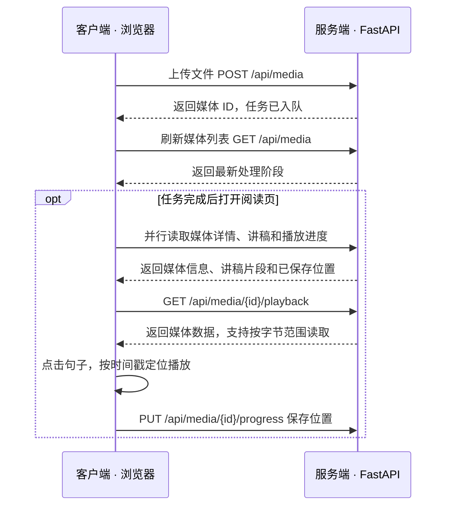

# 使用与 API 参考

返回 [README](README.md)。本文件描述当前已实现接口，完整 Schema 由运行服务的 `/openapi.json` 提供。



后台领取任务、处理音轨和发布讲稿的步骤见[完整流程图](README.md#一段录音如何变成可点击的讲稿)。安装步骤见[首次启动](README.md#首次启动)。队列停住时见[常见问题](#常见问题)。

## 部署配置参考

配置通过启动终端的环境变量传入，当前不自动读取 `.env` 文件。

| 环境变量 | 默认值 | 用途 |
| --- | --- | --- |
| `RECUE_HOST` | `127.0.0.1` | API 监听地址 |
| `RECUE_PORT` | `4318` | API 端口 |
| `RECUE_DATA_DIR` | 项目下 `data/` | 数据库、原文件、播放副本与运行记录；自定义时须用绝对路径 |
| `RECUE_FFMPEG` | `ffmpeg` | FFmpeg 命令或绝对路径；FFprobe 在处理 JSON 中设置 |
| `RECUE_PROCESSING_CONFIG` | 未设置 | 处理 JSON 的绝对路径，交互启动时自动设置 |
| `RECUE_MODEL_PATH` | 未设置 | 旧预检兼容项，仅检查文件存在，不能替代处理 JSON |

开发中使用过 whisper.cpp `b5454` 与 `medium-q5_0`，仅为可运行基线，不作为质量推荐。工具、模型、本地配置和数据不进入 Git；请记录实际固定版本、下载来源和文件哈希。依赖与模型准备后，启动使用 `uv --offline --locked`，前端无 CDN；整机断网后的完整流程尚待验收。

支持 `--service api` 或 `--service worker` 分开启停；使用同一数据目录并以相同参数停止各自入口。

依赖完整性检查：`uv lock --check --offline`、`uv pip check`。其余开发检查见 README。

### 准备转写配置

双击项目根目录的 `Start.cmd`，或在终端运行 `node scripts/recue.mjs launch`。第一次输入 whisper-cli.exe 和多语言 GGML 模型的路径后，脚本将绝对路径和 SHA-256 保存到 `processing.local.json`，随后启动网页和后台进程。再次启动会复用该文件。

更换工具或模型时，先停止服务，将旧配置改名保存，再运行启动脚本重新选择。已设置 `RECUE_PROCESSING_CONFIG` 时，启动脚本优先使用它指定的配置。需要记录发布版本、源码 commit 或模型 revision 时，可按[配置示例](examples/processing.example.json)补充；问答生成的配置将这些来源字段标记为 `unrecorded`。

## 上传与接收

- `POST /api/media?display_name=URL编码文件名`：请求头 `X-Upload-ID` 为客户端生成的 UUID，`Content-Type: application/octet-stream`，请求体为原始字节，不使用 multipart。
- 首次完整接收返回 201 及 `request_id/media_id/job_id/status`。`status=received` 只表示保存并入队，音轨、时长、可解码性和转写仍须后台验证。
- `GET /api/uploads/{request_id}` 查询已完成接收结果。响应不明时先查询；404 表示尚无完整接收记录，上传可能仍在进行。
- 相同 ID 重放已完成请求返回 200 和原结果，即使内容不同也不会替换原文件；上传新文件必须使用新 ID。不是断点续传。
- 同时只接收一个新文件，其余返回 409 `upload_busy`。上限为 4 GiB（4,294,967,296 字节），按实际接收字节检查；空文件、超限或中断不入队。磁盘空间不足返回 507，连续 60 秒没有新数据超时。
- 前端每批最多选择 5 个文件并串行上传。处理阶段只显示真实状态与耗时，不提供估算百分比。

API 启动及运行中每小时扫描遗留上传文件，与上传共用系统锁；活跃上传时跳过扫描。清理 UUID 临时文件及超过 24 小时且无数据库引用的原文件，保留已登记媒体及未知文件，失败留待后续重试。不要手工向服务管理的 UUID 目录放入文件。

## 媒体与任务

| 接口 | 行为 |
| --- | --- |
| `GET /api/media?limit=20&cursor=...` | 按 `created_at/id` 倒序，返回 `items/next_cursor`；limit 为 1–100；`next_cursor=null` 表示末页 |
| `GET /api/media/{media_id}` | 媒体元数据和 `latest_job`，含真实状态、阶段、attempt、错误和处理配置，不暴露服务端路径 |
| `POST /api/media/{media_id}/retry` | 仅 active 且失败/中断的媒体可重试，新建 attempt，返回 201；并发重复或冲突 409，不存在 404 |
| `GET /api/media/{media_id}/transcript` | 完整发布的 version 和稳定片段 `id/sequence/start_ms/end_ms/text`；未就绪 409，不存在 404 |
| `GET /api/media/{media_id}/playback` | 只提供 active 且最新任务成功的已发布 MP4/M4A；支持 HEAD、Range 200/206/416；未就绪 409，不存在 404，副本缺失 503 |
| `GET /api/health` | API、数据库、worker 和转写配置就绪状态 |

API 日期和 `started_at` 为 Unix 毫秒；讲稿时间为相对播放起点的整数毫秒。未验证的媒体类型或时长为 null。

## 处理与时间轴

单 worker 使用实例锁与短事务 FIFO 领取任务，保存处理配置快照。每次 attempt 使用独立目录，依次执行真实预处理、CPU 转写、时间校验和讲稿整理，讲稿、播放路径、元数据和成功状态在同一事务发布；失败不公开半成品。

FFmpeg 生成 H.264/AAC MP4（音频为 AAC M4A）及 16 kHz 单声道 PCM。映射为 `source_pts_seconds - source_origin_seconds`，音视频共用原点，保留初始偏移和内部间隙。不删除静音，不平均分配时间。异常转写时间戳拒绝发布。点击讲稿从 `max(0, start_ms - 300)` 开始播放，原始讲稿时间戳不变。

`RECUE_PROCESSING_CONFIG` 指向显式部署 JSON，字段见 [示例](examples/processing.example.json)。worker 校验版本、CPU 后端、工具/模型的 SHA-256、FFmpeg 与 FFprobe；固定中文、8 线程、单处理器、不启用 VAD/分块。缺失或无效时为 `blocked_config`，不领取排队任务。修改后重启 worker，不自动选模型或降级。`health.transcription_ready` 只代表配置就绪，不代表质量达标。

## 停止与恢复

单独重启 API 不影响运行任务。重启 worker 前先确认旧工具进程树清理，再把遗留运行任务标记为 interrupted，排队任务保留；中断任务可手动重试，不承诺从转写中途续算。

`node scripts/recue.mjs stop` 只写停止请求，命令返回不代表服务已经退出。先等启动终端结束，再确认 `runtime/processing.guard` 已由 guardian 清除；异常退出后 guardian 可能还需一段时间。分开启停时分别对原来的 api、worker 启动终端发出停止请求，`--service all` 不会停止分别启动的两个入口。备份前也须停止直接运行的 uvicorn/worker 实例。

`GET /api/health` 的 `status=ok` 表示 API/数据库可用；`worker.status=processing` 和 `transcription_ready=true` 表示处理配置就绪，也可能正在空闲等待队列，不是当前一定有识别任务，更不代表模型质量通过。`offline` 或 `blocked_config` 时不能据 API 可访问判断转写正常。

Windows 工具创建时即纳入 Job Object，超时、取消或宿主退出后清理后代。独立 guardian 保留外层句柄，确认整树退出后才移除 `runtime/processing.guard`。清理失败、guardian 异常退出或断电留下标记时保守阻止启动，错误见 `runtime/guardian.log`；未核实整树退出前不要删除标记。删除运行媒体时先请求取消，工具整树退出后才清理文件；若 worker 异常退出，须在 guardian 确认清理后重启 worker 才能恢复遗留运行状态。

## 常见问题

- **队列不动**：检查健康状态和启动终端输出；`blocked_config` 时检查配置绝对路径、文件哈希（小写）、工具路径，修正后重启 worker。
- **缺少前端**：运行 `node scripts/recue.mjs setup` 或 `npm --prefix frontend run build`；不要在服务进行 HTTP 验证时同时重写构建目录。
- **端口占用**：停止已有实例或设置 `RECUE_PORT`，分开运行的 API 与 worker 使用同一数据目录。
- **uv 找不到**：按官方说明安装并刷新 PATH；通用入口兼容用户目录 `.local/bin` 的默认安装位置。
- **停止无效**：核对 `--service` 和绝对路径 `RECUE_DATA_DIR` 是否与启动一致；stop 写入请求后，须等待启动终端退出。
- **macOS/Linux 无法转写**：当前工具进程保护仍依赖 Windows Job Object；仅可用 `start --service api` 进行 API/界面开发。

## 搜索与复习

在阅读页搜索当前完整讲稿：中文按字面子串匹配，英文字母忽略大小写，按命中位置计数（含重叠匹配）。↑/↓按钮或 Enter/Shift+Enter 切换结果；搜索只滚动讲稿，点击句子才定位并播放。

播放句显示蓝色底色和左边线；关键词为黄色，当前搜索结果为橙色。静音间隙清除播放高亮。滚轮、触摸滑动、滚动条或翻页键暂停自动跟随，高亮仍会更新；点击“回到当前播放句”恢复跟随。

播放中每 5 秒及暂停、跳转时将进度保存到服务端，保存失败时可重试。重开恢复位置并保持暂停；播放完成后停在末尾，可从头播放。同一标签页串行合并保存请求，多标签页采用最后一次有效写入覆盖。关闭页面时仅尽力补充保存，突然断电或网络中断可能丢失尚未保存的进度。


## 删除媒体

列表点击“删除”，确认后原文件、播放副本、讲稿和进度一并清理，无法恢复。排队任务立即撤销；运行任务先取消，确认退出后再清理。删除中不能阅读或重试处理；清理失败会显示原因，关闭占用程序或修复权限后点击“重试删除”。API 重启会继续未完成的删除；删除失败须手动重试。

`DELETE /api/media/{media_id}` 返回 202，表示删除请求已接受，文件可能仍在清理。重复请求安全，包括已不存在的 ID。详情/列表的 lifecycle 为 deleting 或 delete_failed，delete_error 提供清理错误；清理完成后详情返回 404。请求响应丢失时查询列表或安全重试删除。清理忙时可能返回 503，请稍后查询或重试。

删除会保留不含文件名、讲稿和进度的上传 ID 留痕，防止旧请求重放重新创建媒体。对应的上传结果查询和旧 ID 重传返回 410 upload_deleted；若要重新导入，请重新选择文件生成新上传 ID。该查询并非断点续传。

## 停服务备份与恢复

此流程用于同一版本应用的数据恢复。数据库中的媒体路径相对数据目录保存，可以恢复到另一个绝对路径。恢复旧备份会回到备份时的状态，包括之后发生的删除和进度变化；不要把不同时间的数据库与媒体混用，也不要合并覆盖现用数据。

1. 暂停上传，停止所有使用该数据目录的 API/worker，等待启动终端退出及 guardian 清理。确认没有相关服务或工具仍在使用目录，`runtime/processing.guard` 不存在。目录中的 `.lock` 文件可在服务退出后留存，存在本身不表示锁仍被占用；不要靠删除锁文件停止服务。备份期间保持服务停止。
2. 在 PowerShell 填写真实绝对路径，将整个数据目录复制到**不存在的新目录**。以下命令不下载依赖，不删除源文件；`robocopy` 的返回码 0–7 表示无复制失败，8 以上须检查并保留失败副本，另选新目录重做。

```powershell
$dataSource = 'C:\ReCue\data'
$backupTarget = 'E:\ReCueBackups\snapshot-20261113'
if (!(Test-Path -LiteralPath "$dataSource\recue.sqlite3")) { throw '数据库不存在' }
if (Test-Path -LiteralPath "$dataSource\runtime\processing.guard") { throw '工具清理尚未确认，停止备份' }
if (Test-Path -LiteralPath $backupTarget) { throw '请选择不存在的新备份目录' }
robocopy $dataSource $backupTarget /E /COPY:DAT /DCOPY:DAT /R:0 /W:0 /XJ /XF *.lock
if ($LASTEXITCODE -ge 8) { throw '备份复制失败，检查输出' }
```

保留 `recue.sqlite3` 及同目录可能存在的 `recue.sqlite3-wal`、`recue.sqlite3-shm`，并配套复制 `media/`；不要只拷贝主数据库。上述命令同时保留日志与临时目录，排除可重建的锁文件。使用普通本地目录，避免 junction/符号链接；`/XJ` 会跳过 junction，若数据曾被手工迁移为链接，应先核实实体文件，不将跳过的内容视为已备份。另行保管处理 JSON、工具完整目录（含 DLL）、模型及对应哈希、应用版本和锁文件。

3. 保持服务停止，将备份复制到另一个不存在的新目录，再切换 `RECUE_DATA_DIR`，保留原目录以便回退：

```powershell
$restoreTarget = 'C:\ReCue\restored-data'
if (Test-Path -LiteralPath $restoreTarget) { throw '请选择不存在的新恢复目录' }
if (Test-Path -LiteralPath "$backupTarget\runtime\processing.guard") { throw '备份包含未确认的清理标记，不启动' }
robocopy $backupTarget $restoreTarget /E /COPY:DAT /DCOPY:DAT /R:0 /W:0 /XJ /XF *.lock
if ($LASTEXITCODE -ge 8) { throw '恢复复制失败，不启动服务' }


```

4. 在 Git Bash 运行 `RECUE_DATA_DIR=C:/ReCue/restored-data bash scripts/start.sh`（替换为实际恢复目录并沿用原部署配置）。查看健康状态、媒体列表及失败/中断记录，打开已完成媒体，核对讲稿、远端播放定位和保存进度。已删除媒体应仍不可见，旧上传 ID 查询应为 410。运行任务在停机后可能恢复为 interrupted，需要手动重试；备份不承诺识别中途续算。复核完成后再接收新上传。回退时先完整停止恢复实例，再把环境变量改回原目录，不能同时启动两份数据处理同一批操作。

## 可信局域网与离线验收准备

在处理电脑的 Bash 启动终端设置 `export RECUE_HOST=0.0.0.0`，启动后用 `ipconfig` 查找当前可信网络的 IPv4 地址。第二台电脑访问 `http://处理电脑IPv4:4318/`，无需安装 Python、模型或工具。按 Windows 防火墙提示仅允许可信的专用网络；需要手动规则时，将 TCP 端口限制在本地子网。仓库不自动修改防火墙。

验收时在第二台电脑选择并上传新文件，确认后台完成，再打开讲稿、搜索和点击句子播放；刷新应恢复已保存位置且暂停。记录两端系统/浏览器、访问地址、媒体时长、处理结果和错误。处理电脑自访局域网 IP 不能替代第二台设备。

首次联网准备完依赖后，保留 Node、uv 管理的 Python、项目 `.venv`、`frontend/dist`、FFmpeg/FFprobe、Whisper 完整运行目录与本地模型，配置全部指向本地资源。`setup` 是安装步骤，需要网络，不是离线启动命令；日常使用 `start` 的 `uv --offline --locked`。跨电脑复制 `.venv` 不保证可用，应在目标处理电脑先完成安装。

真实离线验收须阻断互联网且保留两台设备间的局域网（或单独记录本机断网范围），冷启动服务及全新浏览器会话，通过新上传执行识别→讲稿→搜索→播放→进度恢复，记录网络状态和浏览器请求。`uv --offline`、静态资源无 CDN、浏览器模拟离线或已有成果可读都只属于准备检查，不能替代这项验收。目前第二台电脑及真实断网全流程仍未通过。
